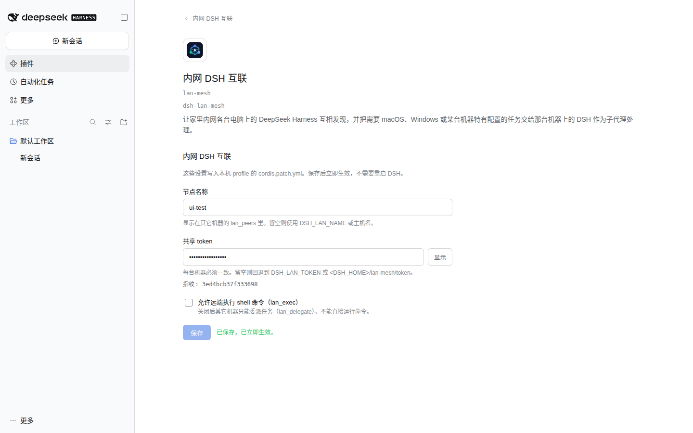

# dsh-lan-mesh

**Call the DeepSeek Harness agents on your other home-network computers as subagents.**

`dsh-lan-mesh` is a DeepSeek Harness (DSH) bundle that you install on every computer on your home LAN. Each machine starts a small authenticated peer server and adds four model-facing tools. The agent on machine A can then hand a task to the DSH agent on machine B — it runs as a fresh, visible DSH session with **B's** profile, tools, model, sandbox and approval policy — and A gets the final answer back.

That is useful whenever the job needs a machine you are not sitting at:

- “Build and codesign this on the Mac mini” (Xcode, `codesign`, macOS-only CLIs).
- “Check whether Visual Studio is installed and run this on the Windows PC.”
- “Read the config on the media server and restart the service.”
- “Run `docker ps` on the box that actually runs Docker.”

There is no cloud service and no account. Everything stays on your LAN: one bundle on every machine, one shared token, plain HTTP between machines.

| Item | Value |
|---|---|
| Peer server | TCP **7317** (`port`) |
| Discovery | UDP broadcast **7318** (`discoveryPort`), one beacon every 5 s |
| Authentication | Shared bearer token; only `GET /v1/ping` is unauthenticated |
| Transport | Plain HTTP + JSON on the LAN (no TLS) |
| Architecture | Peer-to-peer; no relay, no server, no account |
| Settings | Peer name, shared token and the `lan_exec` switch are editable on the bundle's Plugins page |
| Receiving machine | Must run a Web or Desktop DSH profile for `lan_delegate` |
| Tools added | `lan_peers`, `lan_delegate`, `lan_result`, `lan_exec` |

## What it does

- **Discovers peers automatically.** Every machine broadcasts a small JSON beacon on UDP 7318 and listens for the beacons of the other machines. Beacons carry the peer name, platform, port and a *token fingerprint* — never the token itself. Beacons with a different token fingerprint, and beacons from this instance itself, are ignored.
- **Accepts delegated tasks.** `POST /v1/task` creates a normal, visible DSH session on the receiving machine (the same path as pressing “New session” in the Web GUI) and drives it with one self-contained prompt. The peer session shows up in that machine's session list and follows that machine's configuration.
- **Returns the final answer.** When the remote agent goes idle (including any subagents it started), the last assistant text and the turn's stop reason are sent back to the caller.
- **Runs raw commands.** `POST /v1/exec` runs one shell command on the peer with the peer user's permissions and returns exit code, stdout and stderr. Useful for quick capability probes.
- **Tells the model what is available.** While at least one peer is online, the plugin adds one short line to the system prompt listing those peers, so the model knows delegation is possible. With no peers the contribution is empty and costs nothing.
- **Works on macOS, Windows and Linux.** It imports no third-party module and only Node built-ins that ship with DSH. Its one optional `@deepseek-ai` import is the Host's own `schemastery`, used solely to expose the settings form; when that package cannot be resolved the plugin loads unchanged and simply has no form.

## What it does not do

This is deliberately a small peer mesh, not a remote-access product:

- **No TLS / no encryption.** Traffic between peers is plain HTTP. Run it only on a trusted home LAN.
- **No pairing UI, no account, no cloud relay.** There is nothing to sign in to; the shared token is the entire access control.
- **No multicast / mDNS discovery.** Discovery is UDP broadcast only. Broadcast does not cross routers, VLANs or subnets — use static peers there.
- **No `/lan` chat command.** The local model calls the four tools; you talk to it normally.
- **No remote desktop, no screen control.**
- **No file-transfer tool.** A remote agent can read and write files on its own machine and report text back; there is no file sync between machines. (You can still run `scp`/`rsync` through `lan_exec` yourself.)
- **No full settings surface.** Only three fields — peer name, shared token, and the `lan_exec` switch — are editable on the bundle's page in the Plugins sidebar. Ports, discovery, static peers and timeouts stay in the profile YAML.
- **No shared conversation.** The remote agent cannot see the caller's context, history or files; the task must be self-contained.
- **No cancellation tool and no queue.** There is no tool to cancel a running remote turn, and completed run records live only in memory (kept for 2 hours, at most 100, gone after a restart).
- **No approval bypass.** The peer's own approval policy still applies. If a delegated task needs an approval that nobody answers, it stalls on the peer.
- **No public exposure.** Do not port-forward 7317 or 7318. It is designed for one LAN.

## Requirements

- **DSH on every machine**, with this bundle installed in the profile that runs (see [Quick start](#quick-start-two-or-three-machines)).
- **A working token on every machine.** The simple setup is one shared token everywhere: a token is generated on first run, but each machine generates its own, so share one (see [Configuration](#configuration)); a static peer entry may carry its own `token` instead.
- **The same LAN.** All machines must be able to reach each other's TCP port. For automatic discovery they must share a broadcast domain; otherwise configure static peers.
- **A Web or Desktop profile on the machine that receives tasks.** `lan_delegate` needs the profile to compose `sessionController` and `agents` (this is what the Web and Desktop apps do). Machines running `dsh --profile headless` can still be called with `lan_exec`, but delegation is refused with `NO_AGENT_RUNTIME`.
- **Free ports.** TCP 7317 and UDP 7318 per machine by default. One profile per machine should run the plugin; two DSH processes on the same machine will fight over 7317 unless you give one a different `port`.
- No extra Python/Node modules, no credentials, no external services.

## How it works

```
  machine A (linux)                              machine B (macOS)
 ┌──────────────────────────────┐              ┌──────────────────────────────┐
 │ local Agent                  │              │ local Agent                  │
 │   │ lan_delegate             │   HTTP+token │   │                          │
 │   ▼                          │ ───────────► │   ▼                          │
 │ PeerClient ──────────────────┼── POST       │ MeshServer                   │
 │                              │  /v1/task    │   │ TaskRunner                │
 │ TaskRunner (server side)     │ ◄─────────── │   ▼                          │
 │ MeshServer                   │   answer     │ sessionController.create     │
 │ UDP beacon ◄─────────────────┼──────────────┼──► Agent.followup           │
 └──────────────────────────────┘  discovery   └──────────────────────────────┘
```

On every machine the bundle starts:

1. **Peer server** (`bind:0.0.0.0:7317` by default) — authenticated JSON endpoints for handshake, task submission, task polling and raw commands. Request bodies are capped at 1 MiB.
2. **UDP discovery** (port 7318) — broadcasts to `255.255.255.255` and to each interface's subnet broadcast address every `announceMs`, and merges received beacons into a peer registry. Discovered peers are considered online for 3 announce periods (about 15 s at the default 5 s) and are dropped after 10 minutes offline.
3. **Peer registry** — static peers from configuration plus discovered peers. Static entries are always listed as online (their address is authoritative) and absorb a beacon with the same name.
4. **Four tools** — `lan_peers`, `lan_delegate`, `lan_result`, `lan_exec` (see [The four tools](#the-four-tools)).
5. **A conditional system-prompt line** — lists online peers while any exist.

A delegated task is *not* a special sandbox. The receiving machine creates its own session through `ctx.sessionController.create({ cwd })`, submits the task as one user message, waits for the agent to become idle (and for its subagents), then extracts the last assistant text and the turn's stop reason. Consequently the remote agent:

- uses the peer's profile, preset, model selection, tools, sandbox and approval policy;
- appears in the peer's GUI session list, where you can watch or intervene;
- cannot see the caller's conversation, so the delegated task must contain every detail it needs.

## Quick start (two or three machines)

The examples use profile `web`; substitute your profile name (for the Desktop app it is `desktop`, and the app must have been opened once to create it). The bundle directory has to exist on **each** machine — copy the `dsh-lan-mesh` folder there (USB stick, `scp`, file share) and use that absolute path below.

**1. Quit DSH.** Stop `dsh web` or fully quit the Desktop app before changing the profile.

**2. Install the bundle into the existing profile** on every machine:

```sh
dsh plugin --profile web add /absolute/path/to/dsh-lan-mesh
```

This adds both the dependency and the bundle row to the profile. Keep the bundle directory where it is — the profile references that path, so moving or deleting it breaks the bundle on the next start. (Alternative: ask the local DSH agent to install the bundle directory with the `plugin_manager` `install_bundle` tool, passing the absolute package directory.)

**3. Start DSH and check the log.** You should see a line like:

```
lan-mesh: ready as "mac-mini" (id 4f2a9c1b7e33, token generated:/Users/you/.dsh/lan-mesh/token)
```

If the bundle row did not load, `lan_peers` later reports no peers — see [Troubleshooting](#troubleshooting).

**4. Share one token.** On the first machine, print the generated token:

```sh
# macOS / Linux (DSH_HOME defaults to ~/.dsh)
cat "${DSH_HOME:-$HOME/.dsh}/lan-mesh/token"
```

```powershell
# Windows PowerShell (DSH_HOME defaults to %USERPROFILE%\.dsh)
Get-Content (Join-Path $(if ($env:DSH_HOME) { $env:DSH_HOME } else { Join-Path $env:USERPROFILE '.dsh' }) 'lan-mesh\token')
```

Copy that string to every other machine — either into the same token file (macOS/Linux: `mkdir -p`, `printf '%s\n' '<token>' > ...`, `chmod 600`; Windows: `Set-Content -NoNewline`), or set it as the config `token` or the `DSH_LAN_TOKEN` environment variable. All three are covered in [docs/SETUP.md](docs/SETUP.md#step-2-share-one-token).

**5. Restart DSH on the machines whose token changed.** The token is read once at plugin start.

> Tip (Web/Desktop with HMR): if you only want to pick up a changed token or a changed `name`, you do not have to restart the whole app. Add or edit a `lan-mesh` row override in the profile's `cordis.patch.yml` (see [Configuration](#configuration)) — saving it hot-reloads the plugin, which re-reads the token file, and the peer re-announces under the new name within a few seconds.

**6. Verify.** On each machine:

```sh
curl -s http://127.0.0.1:7317/v1/ping
# {"ok":true,"proto":1}
```

Then open a DSH session on any machine and ask:

> Call `lan_peers` and tell me which machines are online and whether they support delegated tasks.

Expected: each other machine listed as `online` with `agent=yes exec=yes token=matches`. Delegation test:

> Use `lan_delegate` to ask `<peer name>` to reply with exactly `LAN-MESH-OK`.

The remote session appears on the peer machine's session list, and the answer comes back as the tool result. A raw-command test:

> Use `lan_exec` on `<peer name>` to run `uname -a` (macOS/Linux) or `ver` (Windows) and show the output.

## Configuration

Settings are read from this plugin's Loader row `config`, so they belong in the profile's user patch file:

```
<DSH_HOME>/profiles/<profile>/cordis.patch.yml
```

`DSH_HOME` defaults to `~/.dsh` (macOS/Linux) or `%USERPROFILE%\.dsh` (Windows). The file is a YAML array of patch entries; add or edit the row for `lan-mesh`:

```yaml
- id: lan-mesh
  name: dsh-lan-mesh
  config:
    name: mac-mini
    token: the-same-long-secret-on-every-machine
    taskCwd: /Users/you/projects
```

All keys are optional: with no `config` row at all the plugin uses the defaults below. Invalid values do not crash the plugin; the plugin logs a warning and falls back to the default. Changes take effect after restarting DSH. Unknown keys are ignored.

### Keys and defaults

| Key | Default | Type / range | Meaning |
|---|---|---|---|
| `name` | OS host name | string | Peer name shown to the other machines. Also falls back to `DSH_LAN_NAME`. |
| `port` | `7317` | integer 1–65535 | Peer server TCP port. |
| `bind` | `0.0.0.0` | string | Peer server bind address. Set a specific LAN interface address to reduce exposure. |
| `server` | `true` | boolean | Run the peer server. Set `false` on a caller-only machine (it can call peers but cannot be called). |
| `discover` | `true` | boolean | Announce and listen on UDP. Set `false` when broadcast is blocked or on an untrusted network. |
| `discoveryPort` | `7318` | integer 1–65535 | UDP discovery port; must be the same on every machine. |
| `announceMs` | `5000` | integer 1000–300000 | Beacon period in milliseconds. Discovered peers expire after 3 periods. |
| `token` | resolved (below) | string | Shared secret, used for every peer without a per-peer `token`. The same value on every machine in the simple setup. |
| `peers` | `[]` | list of objects | Static peers `{ name, host, port?, token? }`; `port` defaults to 7317. A per-peer `token` overrides the shared token for every call to that peer (handshake, `lan_delegate`, `lan_result`, `lan_exec`); using one shared token on every machine is the simple default. |
| `taskCwd` | `""` | string | Default working directory for delegated tasks on **this** machine. Empty means the profile's own default working directory (or the DSH process directory). |
| `toolTimeoutMs` | `900000` (15 min) | integer 1000–86400000 | Deadline of a `lan_delegate` / `lan_exec` tool call on the caller. |
| `allowExec` | `true` | boolean | Accept remote raw commands (`/v1/exec`). Set `false` to disable `lan_exec` on this machine while keeping delegation. |

### Token resolution order

The shared token is taken from the first source that is non-empty:

1. `config.token` in the Loader row.
2. The `DSH_LAN_TOKEN` environment variable of the DSH process.
3. `<DSH_HOME>/lan-mesh/token` — generated with mode `0600` (directory `0700`) on first run if missing.
4. In memory only — a random token, with a warning, if the file cannot be written. Peers cannot authenticate until you configure one of the persistent sources.

Each machine generates its own token on first run, so a fresh installation will **not** authenticate across machines until you copy one token everywhere (the exception is a static peer entry with its own `token`, which is used for every call to that peer). The `lan_peers` output prints each machine's partial token fingerprint (`sha256(token)` first 16 hex characters) so you can compare without revealing the token.

### Settings page (Plugins sidebar)

The fastest way to configure a machine is the bundle's page in the Web/Desktop GUI: open **Plugins** in the sidebar, open **LAN mesh peers** under **Installed plugins**, and press **Configure** on the `lan-mesh` row. The page warns that these values live in the profile's `cordis.patch.yml`.



| Field | Effect |
|---|---|
| Peer name | The name other machines see in `lan_peers`. Empty uses `DSH_LAN_NAME` or the host name. |
| Shared token | The mesh secret. It overrides `DSH_LAN_TOKEN` and the token file; leaving it empty keeps those fallbacks. The page shows the token's 16-character fingerprint so two machines can be compared without revealing it. |
| Allow remote shell commands | Turns `/v1/exec` (`lan_exec`) on or off for this machine. Delegated tasks (`lan_delegate`) keep working either way. |

These three fields are declared `.volatile()`, so **saving applies them immediately** — the peer re-announces under the new name and starts accepting the new token without a DSH restart. Everything else (ports, static peers, `discover`, `taskCwd`, `toolTimeoutMs`) is validated but belongs in the profile YAML, because changing ports has to rebind sockets.

The form appears only when the Host can expose editable configuration (it needs its own `@deepseek-ai/schemastery`). Without it the page says so and points at the YAML.

### Environment variables

| Variable | Effect |
|---|---|
| `DSH_LAN_TOKEN` | Shared token, used when `config.token` is empty. Must be in the environment of the process that starts DSH. |
| `DSH_LAN_NAME` | Peer name, used when `config.name` is empty. |
| `DSH_HOME` | Where the profile and the generated `lan-mesh/token` file live (default `~/.dsh`). |

### Static peers (VLANs, subnets, broadcast blocked)

When the machines are on different subnets or the access point blocks broadcast, list each peer explicitly. Static peers do not need discovery and are always shown as online; every call is still authenticated.

```yaml
- id: lan-mesh
  name: dsh-lan-mesh
  config:
    name: mac-mini
    token: the-same-long-secret-on-every-machine
    discover: false          # optional: broadcast is useless across subnets
    peers:
      - name: linux-box
        host: 192.168.1.20
        port: 7317
      - name: win-pc
        host: 192.168.1.30   # port defaults to 7317
```

Each machine needs entries for the others. You can combine static peers with discovery. A static entry with the same name as a discovered peer absorbs the beacon, so you see one peer instead of two: the beacon only marks that peer online and adds its platform/protocol facts, while the configured host/port always win — a beacon from a different address cannot redirect calls, so a wrong configured address fails loudly on the first call. A `token` inside a peer entry overrides the shared token for every call to that peer (handshake, `lan_delegate`, `lan_result`, `lan_exec`); using one shared token on every machine is the simple default.

### Caller-only machine

To use a laptop only as a caller (no incoming connections), disable both halves and list peers statically:

```yaml
config:
  name: laptop
  server: false
  discover: false
  peers:
    - { name: mac-mini, host: 192.168.1.20 }
```

With `server: false` the machine reports `server disabled` in `lan_peers`, and the tools still work; `lan_delegate` and `lan_exec` go out to the configured peers. Leaving `discover: true` with `server: false` is allowed but logs a warning — the machine would announce itself with no reachable server.

## The four tools

The tools are registered in the calling agent. The system prompt names the online peers, so the model may delegate without calling `lan_peers` first; `lan_peers` is the authoritative way to get exact names and capabilities.

### Which tool when

| Tool | When the model uses it | Arguments |
|---|---|---|
| `lan_peers` | Before any delegation: find exact peer names/ids, see who is reachable, and check `agent`/`exec` capability and token match. Also the first thing to call when the user asks “what machines do I have?” | `probe` (optional, default `true`) |
| `lan_delegate` | The task needs the other machine's OS, installed software, hardware or configuration, and the remote agent must reason and use its own tools. Returns the remote final answer. | `peer`, `task`, `cwd?`, `timeout_sec?`, `detach?` |
| `lan_result` | A delegation was detached, or it outlived the wait and returned a run id; read status/progress and collect the answer later. | `peer`, `run_id` |
| `lan_exec` | A quick, one-shot shell command: version checks, reading a config value, a capability probe. No agent reasoning needed. Requires `allowExec` on the peer. | `peer`, `command`, `cwd?`, `timeout_sec?` |

### `lan_peers`

Lists peers and probes each online peer with a short authenticated handshake (2 s per peer; pass `probe=false` for an instant list). Peer names or ids can be used in the other tools: an exact id, an exact name (case-insensitive) or a unique name prefix all resolve.

Example output:

```
This machine: "mac-mini" (darwin, http://0.0.0.0:7317, token fingerprint 3f786850e387550f)
linux-box  [7d1f0c2a9b44]  linux  http://192.168.1.20:7317  discovered  online  agent=yes exec=yes token=matches
win-pc  [static:win-pc]  unknown  http://192.168.1.30:7317  configured  online  agent=yes exec=no token=matches
```

- The first line is this machine: its name, platform, bind address and port (or `server disabled`), and the partial token fingerprint.
- Each following line: name, peer id (`static:<name>` for configured peers), platform, URL, `configured`/`discovered`, `online`/`offline`, then the handshake result. `agent=yes` means the peer can run delegated sessions; `exec=yes` means it accepts raw commands.
- A failed probe is shown as `unreachable` and summarized under `Probe failures:`.
- With no known peers it explains the likely causes instead of failing.
- If `server` is disabled on this machine, peers can still be listed and called.

### `lan_delegate`

Delegates one self-contained task to a peer, which runs it as a fresh visible session and returns its final answer.

| Parameter | Required | Meaning |
|---|---|---|
| `peer` | yes | Peer name or id from `lan_peers`. |
| `task` | yes | Self-contained instruction. Max 200,000 characters. The remote agent does not see this conversation, so state the goal, paths, constraints and exactly what to report back. |
| `cwd` | no | Absolute working directory **on the peer**. Must exist there. Defaults to the peer's `taskCwd`, else its profile default directory. |
| `timeout_sec` | no | How long to wait for the remote answer, in seconds. Defaults to `toolTimeoutMs / 1000` (900 s). Capped at 6 hours. |
| `detach` | no | Return a run id immediately instead of waiting. Poll it with `lan_result`. |

Behaviour:

- Synchronous by default: the tool holds until the remote turn ends, then returns the remote final assistant text together with the status (and stop reason or error if anything failed).
- If the peer's task is still running when the wait budget expires, the call returns the partial text and a run id; collect the rest with `lan_result`.
- With `detach: true`, it returns as soon as the peer has created the session and accepted the task, with a run id and session id. This is the right mode for anything that may run longer than the tool deadline.
- The **tool call itself** is bounded by `toolTimeoutMs` (15 min default), independent of `timeout_sec`. A very long wait can be cut off by the tool deadline; the remote turn keeps running on the peer, but the caller may lose the run id — prefer `detach: true` for long work, or raise `toolTimeoutMs`.
- The recorded elapsed time, status, session id and answer of a task can be read for 2 hours after it finishes; records are lost when the peer's DSH restarts.

### `lan_result`

Reads one task by run id. Takes `peer` and `run_id` (both required) and returns the current status, elapsed time, session id, stop reason/error and the answer committed so far. It never waits — poll as needed, for example every few seconds from the agent or with a `curl` loop by hand. An unknown or expired run id is reported as `UNKNOWN_TASK` (HTTP 404).

### `lan_exec`

Runs one shell command on the peer and returns exit code, stdout and stderr.

| Parameter | Required | Meaning |
|---|---|---|
| `peer` | yes | Peer name or id from `lan_peers`. |
| `command` | yes | Command line. Max 100,000 characters. Runs through the system shell with the peer user's permissions. |
| `cwd` | no | Absolute working directory on the peer; same defaults as `lan_delegate`. |
| `timeout_sec` | no | Command timeout in seconds. Defaults to 120, capped at 3600. The process is killed when it expires. |

Notes:

- The command inherits the peer DSH process environment plus `DSH_LAN_MESH=1`, which lets scripts detect that they were run through the mesh.
- Output is captured up to 512 KiB per stream; larger output is truncated (the result says so).
- A non-zero exit code is not an error for the tool — it is returned normally. `timedOut` is set when the command was killed.
- Refused with `EXEC_DISABLED` (HTTP 403) when the peer set `allowExec: false`.
- Commands run non-interactively: no TTY, so prompts/`sudo` password dialogs will hang until the timeout.

### Example: a full flow

```text
You:    My Mac needs to build this. Is the mac-mini reachable?
Agent:  lan_peers()  ->  mac-mini ... online  agent=yes exec=yes token=matches
You:    Ask it to check Xcode and report the version, then build the app in /Users/me/src/app.
Agent:  lan_delegate(peer="mac-mini",
                     task="In /Users/me/src/app run `xcodebuild -version` and then
                           `xcodebuild -scheme App -configuration Release build`.
                           Report the Xcode version and the last 20 lines of build output.")
        -> [mac-mini] completed in 2m31s
           --- remote answer ---
           Xcode 16.2 ...
You:    Next, check the Windows box for Python.
Agent:  lan_exec(peer="win-pc", command="py --version")
```

## Security model

- **The token is the whole access control.** Anyone who holds it can run agent turns on that machine and, with `allowExec: true` (the default), arbitrary shell commands as that machine's user. Treat it like an SSH private key: long, random, never committed, never shared outside the household.
- **Discovery never leaks the secret.** Beacons carry only `sha256(token)` truncated to 16 hex characters; that fingerprint is enough to filter foreign beacons and to diagnose token mismatches, but it cannot be used to authenticate.
- **No transport encryption.** Traffic is plain HTTP; answers and tasks are visible to anything that can capture LAN traffic. Use a trusted, WPA2/WPA3-protected network; on shared or guest Wi-Fi set `discover: false`, use static peers, and consider not enabling the plugin at all.
- **No public exposure.** Never port-forward 7317/7318 or put the peer behind a public reverse proxy. There is no TLS and no account system to protect it.
- **Least privilege.** Set `allowExec: false` on machines where you only ever want delegated agent work; set `server: false` on machines that only call others; set `bind` to one interface address if the machine has several.
- **Peer autonomy is preserved.** A delegated task runs with the peer's sandbox, tool set and approval policy. If an approval is required on the peer and nobody answers, the task stalls there; the caller only sees a timeout or the eventual answer.
- **Token storage.** The generated file is `0600` in a `0700` directory under `DSH_HOME`. If you put the token in `cordis.patch.yml` or an environment variable instead, protect those too: the YAML is a normal user file in the profile, and environment variables are readable by same-user processes.
- **No privilege escalation.** Tasks and commands run as the user running DSH — never as root/Administrator unless DSH itself runs that way (which is not recommended).

## Troubleshooting

### `lan_peers` reports no peers (or only some)

Check in this order:

1. **Is the plugin loaded?** On each machine the DSH log should contain `lan-mesh: ready as "<name>"` and `lan-mesh: peer server listening on ...` / `lan-mesh: discovery listening on udp/7318`. If not, the bundle row is missing or DSH was not restarted after installing — re-check `<DSH_HOME>/profiles/<profile>/package.json` (bundle list and dependency) and the row in `cordis.patch.yml`.
2. **Same token?** Discovery ignores beacons whose token fingerprint differs, and calls to a peer with a different token get 401. Compare the `token fingerprint ...` shown on the first line of `lan_peers` on each machine — with one shared token they must all print the same 16 characters; if a static peer has its own token, compare against the token configured for that peer instead. See [The machines disagree about the token](#the-machines-disagree-about-the-token).
3. **Same broadcast domain?** UDP broadcast does not cross routers, VLANs, subnets, VPN tunnels, VM NAT, or Wi-Fi guest/client-isolation. Static peers are the fix ([Configuration](#static-peers-vlans-subnets-broadcast-blocked)).
4. **Firewall?** UDP 7318 blocked means no automatic discovery but static peers still work; TCP 7317 blocked means probes and calls fail with `unreachable` / `PEER_UNREACHABLE`. Open both, for the right network profile ([docs/SETUP.md](docs/SETUP.md#step-3-firewall)).
5. **`discover: false` on one machine?** That machine will not announce itself; the others cannot discover it (but it can call them, and static peers work both ways).
6. **Is the machine asleep, offline, or on a different network?** Discovered peers expire after 3 announce periods; entries disappear entirely after 10 minutes offline. Static peers remain listed (as online) even when unreachable, and fail at probe time.
7. **Two instances on one machine?** A second DSH process on the same profile/port cannot bind 7317; check the log for a bind error and give one instance a different `port`.

### `401 UNAUTHORIZED`

Every endpoint except `/v1/ping` requires `Authorization: Bearer <token>`, and the server rejects requests with a missing, malformed or different token. The `lan_peers` probe reports such peers as `unreachable` and lists a probe failure containing `missing or invalid bearer token; set the same token on every machine`.

Common causes:

- The machines really do use different tokens (each generated its own on first run).
- One machine sets `DSH_LAN_TOKEN` in its environment, which **overrides** the shared token file, while the others use the file.
- You edited the token in config/`cordis.patch.yml` but did not restart DSH.
- A static peer entry has a per-peer `token` that does not match that peer.
- The token contains quotes because it was pasted into YAML as a quoted scalar inside a plain scalar (for example `token: '"abc"'`); the plugin trims surrounding whitespace only, not quote characters. Use a plain scalar or quote the whole value once.

Verify from the shell (this also proves the server and token work):

```sh
TOKEN=$(cat "${DSH_HOME:-$HOME/.dsh}/lan-mesh/token")
curl -s -o /dev/null -w '%{http_code}\n' http://127.0.0.1:7317/v1/hello          # 401 without token
curl -s -o /dev/null -w '%{http_code}\n' -H "Authorization: Bearer $TOKEN" \
     http://127.0.0.1:7317/v1/hello                                              # 200 with token
```

### The machines disagree about the token

Determine the token actually in use on each machine, in resolution order: the `token` value in the Loader row, then `DSH_LAN_TOKEN`, then `<DSH_HOME>/lan-mesh/token`. The startup log line `lan-mesh: ready as "<name>" (id ..., token config|env:DSH_LAN_TOKEN|file:...|generated:...|memory)` tells you which source won — compare those lines.

Then compare fingerprints. Either read them from the `lan_peers` self line on each machine, or compute them:

```sh
# macOS
printf %s "$TOKEN" | shasum -a 256 | cut -c1-16
# Linux
printf %s "$TOKEN" | sha256sum | cut -c1-16
```

```powershell
# Windows PowerShell
$t = 'PASTE_TOKEN'
$b = [Text.Encoding]::UTF8.GetBytes($t)
[BitConverter]::ToString([Security.Cryptography.SHA256]::Create().ComputeHash($b)).Replace('-','').ToLower().Substring(0,16)
```

The same token string always yields the same 16-character fingerprint. If you intentionally gave a static peer its own token, a different fingerprint between the two machines is expected; make sure each side's peer entry carries the other machine's token. Otherwise, to fix: put one token everywhere (copy the file, set `token` in each config, or set `DSH_LAN_TOKEN` for every DSH process), then restart DSH on every machine that changed.

### `NO_AGENT_RUNTIME` (HTTP 503)

The peer can accept HTTP but its profile cannot create an agent session. `lan_delegate` needs both `sessionController` and `agents`; profiles that do not compose them (for example `headless`) answer delegated tasks with `503 NO_AGENT_RUNTIME`. Fix: run the receiving machine with the Web or Desktop profile. Check with `lan_peers`: `agent=no` means delegation will fail, while `exec=yes` means `lan_exec` still works. This is a property of the peer's profile, not of the token or the network.

### Delegation times out, or you want progress from a long task

- Default wait for `lan_delegate` is `toolTimeoutMs / 1000` = 900 s. A remote agent turn that takes longer is not killed: the peer keeps working, and the call returns the partial answer plus a run id once the peer's wait budget expires.
- The tool call has its own deadline (`toolTimeoutMs`, 15 min by default) that is not extended by `timeout_sec`. If you ask for `timeout_sec: 7200` but leave `toolTimeoutMs` at 900000, the call can still be aborted at 15 min and the run id may never reach you.
- For long tasks, call with `detach: true`, note the `run id`, then poll `lan_result` (or `GET /v1/task/<runId>`) every few seconds. Completed records survive 2 hours and up to 100 tasks in memory; a restart loses them and old ids become `UNKNOWN_TASK`.
- If the caller was interrupted between submitting and receiving the id, the remote session is visible in the peer's GUI — read the answer there or find the run only in the peer's log.
- There is no cancel tool. If a remote turn should stop, stop it on the peer machine (its GUI session).
- A task that is waiting for an approval on the peer looks like a timeout. Watch the peer's GUI and approve, or design tasks that need no approval.
- Network errors surface as `PEER_UNREACHABLE` (TCP connection failed), `PEER_TIMEOUT` (no answer within the request budget) or `PEER_ABORTED` (the local tool call was cancelled).

### Firewall problems

Symptom: `lan_peers` shows peers but probes say `unreachable`, or the peer list is empty while static peers work. The peer needs **inbound** TCP on `port` (7317) and **inbound** UDP on `discoveryPort` (7318). Outbound is normally allowed. Open both in an elevated Command Prompt or PowerShell on Windows (add `profile=private` to scope the rules to private/home networks):

```bat
netsh advfirewall firewall add rule name="DSH LAN mesh" dir=in action=allow protocol=TCP localport=7317
netsh advfirewall firewall add rule name="DSH LAN mesh" dir=in action=allow protocol=UDP localport=7318
```

macOS shows an incoming-connections prompt for `node` the first time the server listens — click **Allow**; if it was dismissed, enable the app under System Settings → Network → Firewall → Options, and allow Local Network access under Privacy & Security if asked. Linux: allow the two ports in `ufw`/`firewalld` (exact commands in [docs/SETUP.md](docs/SETUP.md#step-3-firewall)).

### Other common errors

| Symptom | Meaning | Fix |
|---|---|---|
| `EADDRINUSE` / `peer server cannot start on 0.0.0.0:7317` | Another process (often a second DSH) owns the port. | Stop the other instance or set a different `port` on one of them (static peers need the changed port). |
| `BAD_CWD` | The `cwd` does not exist as a directory on the peer. | Use an absolute path that exists on that machine, or omit `cwd`/set `taskCwd`. |
| `EXEC_DISABLED` | The peer set `allowExec: false`. | Ask the peer's owner to enable it, or use `lan_delegate`. |
| `UNKNOWN_TASK` | Bad or expired run id (or the peer restarted). | Re-submit; ids are not durable. |
| `PEER_UNREACHABLE` | TCP connection failed, or no such host. | Check the peer is running, the address/port are right, and TCP is open. |
| `PEER_TIMEOUT` | Peer did not answer within the request budget; often the server bound but blocked. | Check the peer's process/log; retry; raise timeouts. |
| `agent=no` in `lan_peers` | The peer profile cannot host sessions. | Run that machine's DSH as Web/Desktop. |
| The remote answer is empty | The remote agent produced no text (or the turn failed). | Check the peer session in its GUI; the result includes the stop reason/error. |
| A renamed/readdressed machine appears twice | A peer's id is derived from name + host name + port; an old beacon lingers while offline. | The stale entry disappears after 10 minutes; restart DSH or ignore it. |
| `Auto review rejected tool "lan_exec"` | A session running the experimental Auto review permission mode asks a reviewer model before every tool call; an arbitrary remote shell is a plausible refusal, and a denial is final under `approval-policy never`. | This is a session policy, not a mesh failure: switch that session to a normal permission mode (or answer the approval), or use `lan_delegate`. `lan_peers`/`lan_delegate` normally pass because they name a peer and a task rather than a shell command. The peer's `allowExec` still applies. |

## Verification

### HTTP endpoints

| Method | Path | Auth | Purpose |
|---|---|---|---|
| GET | `/v1/ping` | no | Reachability only: `{ ok, proto }`. |
| GET | `/v1/hello` | yes | Capabilities: `{ ok, proto, tokenFingerprint, name, platform, port, agent, exec, runtimes }`. |
| POST | `/v1/task` | yes | Submit a task: `{ task, cwd?, timeoutMs?, detach? }` → `{ ok, task }`. |
| GET | `/v1/task/<runId>` | yes | Poll a task: `{ ok, task }`. |
| POST | `/v1/exec` | yes | Run a command: `{ command, cwd?, timeoutMs? }` → `{ ok, result }`. |

A `task` is `{ runId, sessionId, cwd, status: "running"|"completed"|"error", output, stopReason, error, startedAt, finishedAt, elapsedMs }`. Errors are `{ ok:false, error:{ code, message } }` with `UNAUTHORIZED` (401), `BAD_REQUEST`/`BAD_CWD` (400), `EXEC_DISABLED` (403), `UNKNOWN_TASK` (404), `NO_AGENT_RUNTIME` (503) and `INTERNAL` (500); an unknown path or method returns 404 with code `NOT_FOUND`, and an oversized or non-JSON body is a 400 `BAD_REQUEST`.

### curl checks (on any machine)

```sh
# 1. Peer server alive, no token needed
curl -s http://127.0.0.1:7317/v1/ping
# -> {"ok":true,"proto":1}

# 2. Token works, peer identity and capability
TOKEN=$(cat "${DSH_HOME:-$HOME/.dsh}/lan-mesh/token")
curl -s -H "Authorization: Bearer $TOKEN" http://127.0.0.1:7317/v1/hello
# -> {"ok":true,"proto":1,"tokenFingerprint":"<16 hex>","name":"...","platform":"...","port":7317,"agent":true,"exec":true,"runtimes":["dsh"]}

# 3. Raw command
curl -s -X POST -H "Authorization: Bearer $TOKEN" -H 'content-type: application/json' \
  -d '{"command":"uname -a"}' http://127.0.0.1:7317/v1/exec
# -> {"ok":true,"result":{"code":0,...,"stdout":"Linux ...\n",...}}

# 4. Real agent turn on this machine (costs one model turn)
curl -s -X POST -H "Authorization: Bearer $TOKEN" -H 'content-type: application/json' \
  -d '{"task":"Reply with exactly: LAN-MESH-OK","timeoutMs":180000}' http://127.0.0.1:7317/v1/task
# -> {"ok":true,"task":{"status":"completed","output":"LAN-MESH-OK",...}}

# 5. Detached task + poll by run id
curl -s -X POST -H "Authorization: Bearer $TOKEN" -H 'content-type: application/json' \
  -d '{"task":"Reply with exactly: LAN-MESH-OK","detach":true}' http://127.0.0.1:7317/v1/task
curl -s -H "Authorization: Bearer $TOKEN" http://127.0.0.1:7317/v1/task/<runId>

# 6. Authentication is required
curl -s -o /dev/null -w '%{http_code}\n' http://127.0.0.1:7317/v1/hello   # 401
```

On Windows use `curl.exe` (PowerShell's `curl` alias is `Invoke-WebRequest`) or `Invoke-RestMethod` — see [docs/SETUP.md](docs/SETUP.md#step-5-verify-two-machines).

### `lan_*` tool flow

From any DSH session on machine A, in this order:

1. “Call `lan_peers`.” → your machine's line with its token fingerprint, then each peer (`online`, `agent=... exec=... token=matches`).
2. “Use `lan_exec` on `<peer>` to run `uname -a`.” → exit code and stdout from the peer.
3. “Delegate to `<peer>`: reply with exactly `LAN-MESH-OK` and nothing else.” → `status completed`, answer `LAN-MESH-OK`.
4. “Delegate to `<peer>` with detach.” → a run id; then “Check `lan_result` for peer `<peer>` run `<id>`.” → `running` or `completed` with the answer.
5. Cross-check in the peer's Web/Desktop GUI: the delegated task appears as a normal session for the working directory. That is the visible-session guarantee.

### Test suite (developers)

The transport and config tests need no model, profile or credentials:

```sh
cd /absolute/path/to/dsh-lan-mesh
node --test test/unit.test.mjs test/server.test.mjs test/plugin.test.mjs
```

They cover config defaults and token resolution, peer discovery/expiry/resolution, protocol helpers, final-output extraction, per-peer token overrides and configured-address precedence, a real `MeshServer` + `PeerClient` round trip over loopback (including 401, 403 and 404 cases), the plugin entry itself mounted under a fake Host context (including live `.volatile()` config reads), and 30 tests in total.

## Stopping, disabling and uninstalling

- **Temporarily disable:** disable the `lan-mesh` bundle in the plugin manager (or remove its row from the profile) and restart DSH.
- **Uninstall:** `dsh plugin --profile web remove dsh-lan-mesh`, then restart DSH. The `<DSH_HOME>/lan-mesh/token` file is not removed automatically — delete it yourself if you want the token gone.
- **Rotate the token:** put the new value everywhere (config/env/file), then restart DSH on every machine. Until all machines restart, the mesh is split.

## Files and design

| File | Role |
|---|---|
| `index.js` | Plugin entry: config, server/discovery wiring, tools, system-prompt line. |
| `lib/config.js` | Validated config and token resolution. |
| `lib/protocol.js` | Wire constants, token comparison, JSON body helpers. |
| `lib/peers.js` | Static + discovered peer registry, name resolution. |
| `lib/discovery.js` | UDP broadcast/listen. |
| `lib/server.js` | Peer HTTP server and endpoints. |
| `lib/runner.js` | Task execution on the peer (agent drive, final text, exec). |
| `lib/client.js` | Caller-side authenticated fetch. |
| `test/unit.test.mjs`, `test/server.test.mjs` | Tests (no model or credentials). |

Architecture and design notes: [DESIGN.md](DESIGN.md). Step-by-step installation, firewall rules and a two-machine verification procedure: [docs/SETUP.md](docs/SETUP.md).
