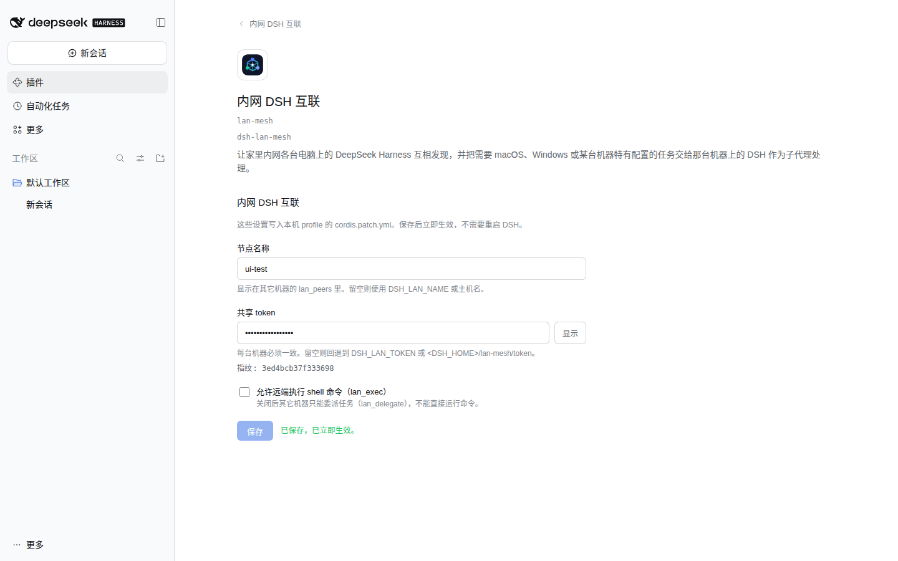

# dsh-lan-mesh（内网 DSH 互联）

**把家里内网其他电脑上的 DeepSeek Harness 智能体当作子代理来调用。**

`dsh-lan-mesh` 是一个 DeepSeek Harness（DSH）捆绑包，装在家里每台跑 DSH 的电脑上。每台机器会启动一个带鉴权的小型对等服务器，并给本机模型增加四个工具。于是 A 机器上的智能体可以把一件任务交给 B 机器上的 DSH 智能体去做——它会在 B 上开一个全新的、可见的 DSH 会话，使用 **B 自己的** profile、工具、模型、沙箱和审批策略，最后把结果带回 A。

下面这些场景就很适合用它：

- “这个 App 要在 Mac mini 上编译并签名。”（Xcode、`codesign` 以及只有 macOS 才有的命令行工具）
- “去 Windows 那台机器上看看有没有装 Visual Studio，然后在那边跑一下。”
- “读一下媒体服务器上的配置文件，把服务重启一下。”
- “在那台真正跑 Docker 的机器上执行 `docker ps`。”

不需要云端服务，也不需要账号。一切都在局域网内完成：每台机器装同一个捆绑包，共用同一个 token，机器之间走普通 HTTP。

| 项目 | 取值 |
|---|---|
| 对等服务器 | TCP **7317**（配置项 `port`） |
| 节点发现 | UDP 广播 **7318**（配置项 `discoveryPort`），每 5 秒发一次信标 |
| 鉴权 | 共享 Bearer token；只有 `GET /v1/ping` 不需要 token |
| 传输 | 局域网内普通 HTTP + JSON（没有 TLS） |
| 架构 | 点对点；没有中继、没有中心服务器、没有账号 |
| 设置界面 | 侧栏「插件」里本插件的行支持配置：节点名称、共享 token、`lan_exec` 开关 |
| 接收方要求 | 想跑 `lan_delegate`，必须运行 Web 或 Desktop profile |
| 新增工具 | `lan_peers`、`lan_delegate`、`lan_result`、`lan_exec` |

## 这个插件做什么

- **自动发现内网节点。** 每台机器在 UDP 7318 上广播一个小型 JSON 信标，同时监听其他机器的信标。信标里有节点名、平台、端口和**token 指纹**——但绝不含 token 本身。token 指纹不同的信标、以及本机自己的信标，都会被忽略。
- **接收委派任务。** `POST /v1/task` 会在接收方机器上创建一个正常的、可见的 DSH 会话（和 Web 界面里点“新会话”走同一条路径），把任务作为一条用户消息喂给它。这个会话会出现在那台机器的会话列表里，并遵循那台机器的配置。
- **带回最终答案。** 远端智能体空闲后（包括它启动的子代理都结束），最后一条助手文本和本轮结束原因会发回调用方。
- **执行原始命令。** `POST /v1/exec` 以对端用户的权限执行一条 shell 命令，返回退出码、stdout 和 stderr，适合做快速能力探测。
- **告诉模型有哪些机器。** 只要至少有一台节点在线，插件就会在系统提示词里加一行，列出这些节点，模型由此知道可以委派。没有节点时这一行为空，不消耗 token。
- **macOS、Windows、Linux 通用。** 它不依赖第三方模块，只用 DSH 自带的 Node 内置模块；唯一可选的 `@deepseek-ai` 导入是宿主自己的 `schemastery`，只用来生成设置表单——解析不到时插件照常加载，只是没有表单。

## 它不做什么

这是一个刻意做小的内网点对点工具，不是远程访问产品：

- **没有 TLS，不加密。** 节点之间是明文 HTTP。只在可信的家庭局域网里使用。
- **没有配对界面、没有账号、没有云端中继。** 没有登录这回事，共享 token 就是全部访问控制。
- **没有组播 / mDNS 发现。** 发现只靠 UDP 广播。广播过不了路由器、VLAN 和子网，这些环境请用静态节点。
- **没有 `/lan` 聊天命令。** 由本机模型去调那四个工具，你照常跟模型说话。
- **没有远程桌面、不能控制屏幕。**
- **没有文件传输工具。** 远端智能体可以读写它自己机器上的文件、把文字结果带回来，但机器之间没有文件同步。（你当然可以自己通过 `lan_exec` 跑 `scp`/`rsync`。）
- **设置界面只覆盖三个字段。** 只有节点名称、共享 token、`lan_exec` 开关能在侧栏「插件」的本插件页里改；端口、发现、静态节点、超时等仍然写在 profile 的 YAML 里。
- **不共享对话上下文。** 远端智能体看不到调用方的上下文、历史记录和文件，所以任务必须自带全部信息。
- **没有取消工具，也没有任务队列。** 没有工具可以取消正在跑的远端回合；任务记录只存在内存里（保留 2 小时，最多 100 条，重启即丢）。
- **不会绕过审批。** 对端自己的审批策略照常生效。如果委派的任务需要审批而没有人点，它就会卡在对端。
- **不面向公网。** 不要把 7317 或 7318 做端口映射。它只为同一个局域网设计。

## 运行条件

- **每台机器都装 DSH**，并且在实际运行的那个 profile 里装好本捆绑包（见[快速开始](#快速开始两三台机器)）。
- **每台机器都要有可用的 token。** 最简单的做法是所有机器共用一个共享 token：token 会在首次运行时自动生成，每台机器各生成各的，所以需要手动统一（见[配置](#配置)）；也可以给静态节点条目单独写 `token`。
- **在同一个局域网。** 所有机器要能访问彼此的 TCP 端口；想自动发现还需要处在同一个广播域，否则请配置静态节点。
- **接收任务的机器要运行 Web 或 Desktop profile。** `lan_delegate` 要求该 profile 组合了 `sessionController` 和 `agents` 服务（Web 和 Desktop 应用都是这样）。用 `dsh --profile headless` 之类的 profile 仍然可以被 `lan_exec` 调用，但委派会被拒绝并返回 `NO_AGENT_RUNTIME`。
- **端口空闲。** 默认每台机器占用 TCP 7317 和 UDP 7318。一台机器上只应有一个 profile 启用本插件；同一台机器跑两个 DSH 进程会争抢 7317，除非给其中一个换 `port`。
- 不需要额外的 Python/Node 模块，不需要凭据，也不依赖任何外部服务。

## 工作原理

```
  A 机器（linux）                                 B 机器（macOS）
 ┌──────────────────────────────┐              ┌──────────────────────────────┐
 │ 本机 Agent                    │              │ 本机 Agent                    │
 │   │ lan_delegate             │  HTTP+token  │   │                          │
 │   ▼                          │ ───────────► │   ▼                          │
 │ PeerClient ──────────────────┼── POST       │ MeshServer                   │
 │                              │  /v1/task    │   │ TaskRunner                │
 │ TaskRunner（服务端）           │ ◄─────────── │   ▼                          │
 │ MeshServer                   │   答案        │ sessionController.create     │
 │ UDP 信标 ◄────────────────────┼──────────────┼──► Agent.followup           │
 └──────────────────────────────┘   节点发现     └──────────────────────────────┘
```

每台机器上的捆绑包会启动：

1. **对等服务器**（默认 `bind:0.0.0.0:7317`）——提供鉴权的 JSON 接口：握手、提交任务、查询任务、执行原始命令。请求体上限 1 MiB。
2. **UDP 发现**（端口 7318）——每 `announceMs` 向 `255.255.255.255` 以及各网卡的子网广播地址发一次信标，同时把收到的信标合并进节点注册表。发现的节点在 3 个宣告周期内视为在线（默认 5 秒周期，即约 15 秒），离线超过 10 分钟后从列表删除。
3. **节点注册表**——配置的静态节点加上发现的节点。静态条目始终显示为在线（配置的主机和端口始终优先），并且会吸收同名的广播信标。
4. **四个工具**——`lan_peers`、`lan_delegate`、`lan_result`、`lan_exec`（见[四个工具](#四个工具)）。
5. **一行条件性系统提示词**——有在线节点时列出它们。

被委派的任务**不是**什么特殊的沙箱。接收方通过 `ctx.sessionController.create({ cwd })` 创建自己的会话，把任务作为一条用户消息提交，等智能体空闲（以及它的子代理结束），然后提取最后一条助手文本和本轮的结束原因。因此远端智能体会：

- 使用对端机器的 profile、预设、模型选择、工具、沙箱和审批策略；
- 出现在对端的图形界面会话列表里，你可以围观或介入；
- 看不到调用方的对话，所以委派的任务必须写全所需信息。

## 快速开始（两三台机器）

下面的例子都用 `web` 这个 profile；请换成你自己的 profile 名（Desktop 应用对应 `desktop`，而且要先打开一次应用把该 profile 创建出来）。**每台**机器上都要有那个捆绑包目录——把 `dsh-lan-mesh` 文件夹复制过去（U 盘、`scp`、文件共享都行），下面用它的绝对路径。

**1. 退出 DSH。** 先停掉 `dsh web`，或完全退出 Desktop 应用，再改 profile。

**2. 在每台机器上把捆绑包装进现有 profile：**

```sh
dsh plugin --profile web add /absolute/path/to/dsh-lan-mesh
```

这条命令会同时把依赖和 bundle 条目写进 profile。请把捆绑包目录放在打算长期保留的位置——profile 记录的是这个路径，之后移动或删除目录会导致下次启动时加载失败。（另一种方式：让本机 DSH 智能体用 `plugin_manager` 的 `install_bundle` 工具安装这个捆绑包目录，传绝对路径即可。）

**3. 启动 DSH 并检查日志。** 应该能看到类似这样的一行：

```
lan-mesh: ready as "mac-mini" (id 4f2a9c1b7e33, token generated:/Users/you/.dsh/lan-mesh/token)
```

如果 bundle 条目没加载，后面 `lan_peers` 会看不到节点——见[常见问题](#常见问题)。

**4. 统一 token。** 在第一台机器上打印自动生成的 token：

```sh
# macOS / Linux（DSH_HOME 默认是 ~/.dsh）
cat "${DSH_HOME:-$HOME/.dsh}/lan-mesh/token"
```

```powershell
# Windows PowerShell（DSH_HOME 默认是 %USERPROFILE%\.dsh）
Get-Content (Join-Path $(if ($env:DSH_HOME) { $env:DSH_HOME } else { Join-Path $env:USERPROFILE '.dsh' }) 'lan-mesh\token')
```

把这个字符串复制到其他每台机器——可以写进同一个 token 文件（macOS/Linux：先 `mkdir -p`，再 `printf '%s\n' '<token>' > ...`，最后 `chmod 600`；Windows：用 `Set-Content -NoNewline`），也可以写成配置里的 `token`，或者设成 `DSH_LAN_TOKEN` 环境变量。三种方式在 [docs/SETUP.md](docs/SETUP.md#step-2-share-one-token)（英文）里都有详细步骤。

**5. 在 token 变过的机器上重启 DSH。** token 只在插件启动时读取一次。

> 小技巧（带 HMR 的 Web/Desktop）：只改 token 或 `name` 时不必重启整个 App。在 profile 的 `cordis.patch.yml` 里加/改一条 `lan-mesh` 行覆盖（见[配置](#配置)），保存后这个插件会被热重载，从而重新读取 token 文件，几秒内就会用新名字重新广播。

**6. 验证。** 在每台机器上执行：

```sh
curl -s http://127.0.0.1:7317/v1/ping
# {"ok":true,"proto":1}
```

然后随便哪台机器上开一个 DSH 会话，对模型说：

> 调用 `lan_peers`，告诉我哪些机器在线、它们是否支持委派任务。

预期：其他每台机器都显示为 `online`，并且有 `agent=yes exec=yes token=matches`。再做一次委派测试：

> 用 `lan_delegate` 让 `<节点名>` 只回复 `LAN-MESH-OK`。

远端会话会出现在对端机器的会话列表里，答案作为工具结果返回。最后做一次原始命令测试：

> 用 `lan_exec` 在 `<节点名>` 上执行 `uname -a`（macOS/Linux）或 `ver`（Windows），把输出给我看。

## 配置

配置来自本插件的 Loader 行 `config`，写在 profile 的用户补丁文件里：

```
<DSH_HOME>/profiles/<profile>/cordis.patch.yml
```

`DSH_HOME` 默认是 `~/.dsh`（macOS/Linux）或 `%USERPROFILE%\.dsh`（Windows）。这个文件是一个 YAML 数组，里面是补丁条目；添加或修改 `lan-mesh` 这一行：

```yaml
- id: lan-mesh
  name: dsh-lan-mesh
  config:
    name: mac-mini
    token: the-same-long-secret-on-every-machine
    taskCwd: /Users/you/projects
```

所有配置项都可选：完全不加 `config` 行也能用，插件会使用下面的默认值。写错的值不会让插件崩溃，只是记一条警告并回退到默认值。改完后重启 DSH 生效。未知的键会被忽略。

### 配置项与默认值

| 配置项 | 默认值 | 类型 / 范围 | 含义 |
|---|---|---|---|
| `name` | 操作系统主机名 | 字符串 | 其他机器看到的节点名；为空时回退到 `DSH_LAN_NAME`。 |
| `port` | `7317` | 整数 1–65535 | 对等服务器 TCP 端口。 |
| `bind` | `0.0.0.0` | 字符串 | 对等服务器绑定地址。想缩小暴露面就填某个具体的局域网网卡地址。 |
| `server` | `true` | 布尔 | 是否运行对等服务器。只当调用方的机器设为 `false`（能调别人，不能被调）。 |
| `discover` | `true` | 布尔 | 是否收发 UDP 广播。广播被屏蔽或在不可信网络里时设为 `false`。 |
| `discoveryPort` | `7318` | 整数 1–65535 | UDP 发现端口，所有机器必须一致。 |
| `announceMs` | `5000` | 整数 1000–300000 | 信标间隔（毫秒）。发现的节点超过 3 个周期未出现即视为离线。 |
| `token` | 见下文 | 字符串 | 共享密钥，用于所有没有单独 `token` 的节点。最简单的做法是每台机器相同。 |
| `peers` | `[]` | 对象列表 | 静态节点 `{ name, host, port?, token? }`；`port` 默认 7317。单个节点的 `token` 会覆盖共享 token，用于对该节点的所有调用（握手、`lan_delegate`、`lan_result`、`lan_exec`）；最简单的做法仍是所有机器共用一个 token。 |
| `taskCwd` | `""` | 字符串 | **本机**接收委派任务时的默认工作目录。留空则用 profile 自己的默认目录（或 DSH 进程目录）。 |
| `toolTimeoutMs` | `900000`（15 分钟） | 整数 1000–86400000 | 调用方 `lan_delegate` / `lan_exec` 工具调用的截止时间。 |
| `allowExec` | `true` | 布尔 | 是否接受远程原始命令（`/v1/exec`）。设为 `false` 可以在这台机器上关掉 `lan_exec`，同时保留委派能力。 |

### Token 的取值顺序

共享 token 按以下顺序取第一个非空值：

1. Loader 行里的 `config.token`。
2. DSH 进程的 `DSH_LAN_TOKEN` 环境变量。
3. `<DSH_HOME>/lan-mesh/token`——首次运行时自动生成，权限 `0600`，所在目录权限 `0700`。
4. 只存在内存里——如果文件写不进去，会生成一个随机 token 并给出警告。在配置好某个持久来源之前，其他节点无法通过鉴权。

每台机器首次运行都会生成自己的 token，所以刚装好的机器之间**不能**互相鉴权，必须把同一个 token 铺到所有机器（例外：给静态节点条目单独写 `token`，对该节点的所有调用都会用它）。`lan_peers` 会打印每台机器的部分 token 指纹（`sha256(token)` 的前 16 个十六进制字符），方便在不泄露 token 的前提下比对。

### 设置界面（侧栏「插件」）

在 Web/Desktop 界面里配置一台机器最省事的方式：侧栏打开**插件**，在**已安装插件**里打开**内网 DSH 互联**，在 `lan-mesh` 那一行点**配置**。页面会提示这些值会写进本机 profile 的 `cordis.patch.yml`。



| 字段 | 作用 |
|---|---|
| 节点名称 | 其它机器的 `lan_peers` 里显示的名字；留空用 `DSH_LAN_NAME` 或主机名。 |
| 共享 token | 内网共享密钥。它会覆盖 `DSH_LAN_TOKEN` 与 token 文件；留空则保留这两种回退。页面会显示 token 的 16 位指纹，两台机器不用暴露 token 就能对比。 |
| 允许远端执行 shell 命令 | 打开/关闭本机的 `/v1/exec`（`lan_exec`）。委派任务（`lan_delegate`）不受影响。 |

这三个字段声明为 `.volatile()`，所以**保存后立即生效**：这台机器会用新名字重新广播、并开始接受新 token，不需要重启 DSH。其余字段（端口、静态节点、`discover`、`taskCwd`、`toolTimeoutMs`）会被校验，但仍写在 YAML 里——改端口必须重新绑定套接字。

表单只在宿主能提供可编辑配置时出现（需要宿主自己的 `@deepseek-ai/schemastery`）；否则页面会说明原因并让你改 YAML。

### 环境变量

| 变量 | 作用 |
|---|---|
| `DSH_LAN_TOKEN` | 共享 token，在 `config.token` 为空时使用。必须出现在启动 DSH 的那个进程的环境里。 |
| `DSH_LAN_NAME` | 节点名，在 `config.name` 为空时使用。 |
| `DSH_HOME` | profile 和自动生成的 `lan-mesh/token` 所在位置（默认 `~/.dsh`）。 |

### 静态节点（跨 VLAN、跨子网、广播被屏蔽）

当机器处在不同子网，或者接入点屏蔽了广播时，就把节点显式列出来。静态节点不依赖发现，始终显示为在线；每次调用仍然要过 token 鉴权。

```yaml
- id: lan-mesh
  name: dsh-lan-mesh
  config:
    name: mac-mini
    token: the-same-long-secret-on-every-machine
    discover: false          # 可选：跨子网时广播本来就没用
    peers:
      - name: linux-box
        host: 192.168.1.20
        port: 7317
      - name: win-pc
        host: 192.168.1.30   # port 默认为 7317
```

每台机器都要配其他机器的条目。静态节点也可以和自动发现同时使用。同名的静态条目会吸收发现的节点，所以你只会看到一条记录，而不是两条：信标只用来标记该节点在线并补充平台/协议信息，配置的主机和端口始终优先——地址不一致的信标无法把调用重定向，配置地址错了会在第一次调用时直接失败。节点条目里的 `token` 会覆盖共享 token，用于对该节点的所有调用（握手、`lan_delegate`、`lan_result`、`lan_exec`）；最简单的做法仍是所有机器共用一个 token。

### 只作为调用方的机器

如果某台笔记本只用来调别人（不接受入站连接），可以把两半都关掉、只配静态节点：

```yaml
config:
  name: laptop
  server: false
  discover: false
  peers:
    - { name: mac-mini, host: 192.168.1.20 }
```

`server: false` 时，`lan_peers` 会显示 `server disabled`，但工具照常可用，`lan_delegate` 和 `lan_exec` 会向配置的节点发出。`server: false` 却保留 `discover: true` 是允许的，不过会记一条警告——这台机器会宣告自己，但别人连不上它的服务器。

## 四个工具

工具注册在调用方的智能体里。系统提示词里会列出在线节点，所以模型不一定先调 `lan_peers` 就会委派；但要拿准确的节点名和能力，`lan_peers` 才是权威来源。

### 什么时候用哪个

| 工具 | 模型什么时候用 | 参数 |
|---|---|---|
| `lan_peers` | 委派之前：拿到准确的节点名/ID，看谁可达，检查 `agent`/`exec` 能力和 token 是否匹配。用户问“我有哪些机器”时也应该先调它。 | `probe`（可选，默认 `true`） |
| `lan_delegate` | 任务需要另一台机器的系统、已装软件、硬件或配置，而且需要远端智能体自己推理、调用工具。返回远端的最终答案。 | `peer`、`task`、`cwd?`、`timeout_sec?`、`detach?` |
| `lan_result` | 委派用了 `detach`，或者等待超时但拿到了 run id，之后用它查看状态/进度并取回答案。 | `peer`、`run_id` |
| `lan_exec` | 一条快速的 shell 命令：查版本、读某个配置值、做能力探测。不需要智能体推理。要求对端 `allowExec` 打开。 | `peer`、`command`、`cwd?`、`timeout_sec?` |

### `lan_peers`

列出节点，并对每台在线节点做一次带鉴权的快速握手（每台 2 秒；传 `probe=false` 可立即返回列表）。其他工具里的节点名或 ID 都可以用：精确 ID、精确名字（忽略大小写）或唯一的名称前缀都能解析。

输出示例：

```
This machine: "mac-mini" (darwin, http://0.0.0.0:7317, token fingerprint 3f786850e387550f)
linux-box  [7d1f0c2a9b44]  linux  http://192.168.1.20:7317  discovered  online  agent=yes exec=yes token=matches
win-pc  [static:win-pc]  unknown  http://192.168.1.30:7317  configured  online  agent=yes exec=no token=matches
```

- 第一行是本机：名字、平台、绑定地址和端口（或 `server disabled`），以及部分 token 指纹。
- 之后每行依次是：名字、节点 ID（配置的节点是 `static:<名字>`）、平台、URL、`configured`/`discovered`、`online`/`offline`，以及握手结果。`agent=yes` 表示对端能跑委派会话；`exec=yes` 表示对端接受原始命令。
- 握手失败会显示 `unreachable`，并在 `Probe failures:` 里汇总原因。
- 一个节点都没有时，它会解释可能的原因，而不是直接报错。
- 本机 `server` 关掉时，仍然可以列出和调用其他节点。

### `lan_delegate`

把一件自带全部信息的任务委派给某个节点，对端以全新的可见会话执行，并返回最终答案。

| 参数 | 必填 | 含义 |
|---|---|---|
| `peer` | 是 | `lan_peers` 里的节点名或 ID。 |
| `task` | 是 | 自带全部信息的任务描述，最多 200,000 字符。远端智能体看不到这段对话，所以要写清目标、路径、约束以及要回报什么。 |
| `cwd` | 否 | **对端机器上**的绝对工作目录，必须存在。默认用对端的 `taskCwd`，再否则用其 profile 默认目录。 |
| `timeout_sec` | 否 | 等待远端答案的秒数，默认 `toolTimeoutMs / 1000`（900 秒），上限 6 小时。 |
| `detach` | 否 | 立即返回 run id 而不等待，之后用 `lan_result` 查询。 |

行为说明：

- 默认同步：工具一直等到远端回合结束，然后返回远端最终助手文本，以及状态（失败时还有结束原因或错误）。
- 如果等待预算用完时对端任务还在跑，调用会返回部分文本和 run id；剩下的内容用 `lan_result` 取。
- `detach: true` 时，对端一创建好会话、接下任务就返回，给出 run id 和 session id。任务可能跑得比较久时应该用这个模式。
- **工具调用本身**受 `toolTimeoutMs`（默认 15 分钟）限制，与 `timeout_sec` 无关。等待时间特别长时可能被工具截止时间打断；远端回合会在对端继续跑，但调用方可能拿不到 run id——长任务请优先用 `detach: true`，或者调大 `toolTimeoutMs`。
- 任务结束后，它的耗时、状态、会话 ID 和答案还能读取 2 小时；对端 DSH 重启后记录即丢。

### `lan_result`

按 run id 读一个任务。参数是 `peer` 和 `run_id`（都必填），返回当前状态、耗时、会话 ID、结束原因/错误以及已经提交的答案。它不会等待——需要的话可以反复轮询，比如隔几秒查一次，或手动用 `curl` 循环。run id 不存在或已过期会返回 `UNKNOWN_TASK`（HTTP 404）。

### `lan_exec`

在对端执行一条 shell 命令，返回退出码、stdout 和 stderr。

| 参数 | 必填 | 含义 |
|---|---|---|
| `peer` | 是 | `lan_peers` 里的节点名或 ID。 |
| `command` | 是 | 命令行，最多 100,000 字符。通过系统 shell、以对端用户的权限执行。 |
| `cwd` | 否 | 对端上的绝对工作目录；默认与 `lan_delegate` 相同。 |
| `timeout_sec` | 否 | 命令超时秒数，默认 120，上限 3600。超时会杀掉进程。 |

注意：

- 命令继承对端 DSH 进程的环境变量，并额外带上 `DSH_LAN_MESH=1`，脚本可以据此判断自己是通过内网互联执行的。
- 每个输出流最多捕获 512 KiB，超出部分截断（结果里会标明）。
- 退出码非零不算工具错误，会照常返回；被超时杀掉时 `timedOut` 为 `true`。
- 对端设置 `allowExec: false` 时会被拒绝，返回 `EXEC_DISABLED`（HTTP 403）。
- 命令是非交互执行的：没有 TTY，所以等待输入或 `sudo` 密码的东西会一直挂到超时。

### 一次完整的调用示例

```text
你：   这个 Mac 项目要编译。先看看 mac-mini 通不通。
模型：  lan_peers()  ->  mac-mini ... online  agent=yes exec=yes token=matches
你：    让它先查 Xcode 版本，然后在 /Users/me/src/app 里编译。
模型：  lan_delegate(peer="mac-mini",
                     task="在 /Users/me/src/app 里执行 `xcodebuild -version`，然后执行
                           `xcodebuild -scheme App -configuration Release build`。
                           报告 Xcode 版本和构建输出的最后 20 行。")
        -> [mac-mini] completed in 2m31s
           --- remote answer ---
           Xcode 16.2 ...
你：    再顺便看看 Windows 那台有没有 Python。
模型：  lan_exec(peer="win-pc", command="py --version")
```

## 安全模型

- **token 就是全部访问控制。** 拿到它的人可以在那台机器上跑智能体回合，并且在 `allowExec: true`（默认）时以那台机器用户的身份执行任意 shell 命令。请像对待 SSH 私钥一样对待它：足够长、随机、不要提交进仓库、不要分享到家庭之外。
- **发现过程不泄露密钥。** 信标里只有截断到 16 个十六进制字符的 `sha256(token)`；这个指纹足以过滤外来信标和诊断 token 不一致，但无法用来通过鉴权。
- **传输不加密。** 流量是明文 HTTP；能抓取局域网流量的人可以看到任务和答案。请使用可信的、开启 WPA2/WPA3 的网络；在共享 Wi-Fi 或访客网络里应设 `discover: false`、改用静态节点，甚至干脆不启用本插件。
- **不要暴露到公网。** 绝不要给 7317/7318 做端口映射，也不要把对等服务器放到公网反向代理后面。它没有 TLS，也没有账号体系来保护自己。
- **最小权限。** 只希望接收委派任务的机器可以设 `allowExec: false`；只调别人的机器设 `server: false`；机器有多个网卡时用 `bind` 只绑一个地址。
- **对端自治。** 委派的任务使用对端的沙箱、工具集和审批策略。如果对端需要审批而没人处理，任务就卡在那里，调用方最终只能看到超时或迟到的答案。
- **token 存储。** 自动生成的文件位于 `DSH_HOME` 下、目录权限 `0700`、文件权限 `0600`。如果改用 `cordis.patch.yml` 或环境变量保存，也请保护好：YAML 是 profile 里的普通用户文件，环境变量对同用户进程可见。
- **不提权。** 任务和命令都以运行 DSH 的用户身份执行——除非 DSH 本身以 root/管理员身份运行（不建议），否则不会提权。

## 常见问题

### `lan_peers` 看不到任何节点（或只看到一部分）

按顺序检查：

1. **插件加载了吗？** 每台机器的 DSH 日志里应该有 `lan-mesh: ready as "<名字>"`，以及 `lan-mesh: peer server listening on ...` / `lan-mesh: discovery listening on udp/7318`。没有的话，说明 bundle 条目缺失或安装后没重启 DSH——检查 `<DSH_HOME>/profiles/<profile>/package.json`（bundle 列表和依赖）以及 `cordis.patch.yml` 里的那一行。
2. **token 一样吗？** 发现过程会忽略 token 指纹不同的信标，token 不同时调用对端会得到 401。对比每台机器 `lan_peers` 第一行里的 `token fingerprint ...`——共用同一个 token 时它们必须显示相同的 16 个字符；如果给静态节点配了单独的 token，则改为对比该节点条目里的 token。见[两台机器的 token 对不上](#两台机器的-token-对不上)。
3. **在同一个广播域吗？** UDP 广播过不了路由器、VLAN、子网、VPN 隧道、虚拟机 NAT，也过不了带客户端隔离的 Wi-Fi 访客网络。解决办法是用静态节点（见[静态节点](#静态节点跨-vlan跨子网广播被屏蔽)）。
4. **防火墙？** UDP 7318 被挡只影响自动发现，静态节点仍然可用；TCP 7317 被挡会让探测和调用失败（`unreachable` / `PEER_UNREACHABLE`）。两个端口都要放行，而且要放行正确的网络类型（见 [docs/SETUP.md](docs/SETUP.md#step-3-firewall)）。
5. **某台机器设了 `discover: false`？** 那台机器不会广播自己，别人发现不了它（但它能调别人，静态节点双向都可用）。
6. **机器休眠、离线或换了网络？** 发现的节点 3 个宣告周期后过期，离线超过 10 分钟会从列表消失。静态节点会一直显示为在线，直到探测时才失败。
7. **一台机器跑了两份 DSH？** 同一个 profile/端口的第二个 DSH 进程绑不上 7317；看日志里的绑定错误，给其中一个实例换 `port`。

### `401 UNAUTHORIZED`

除 `/v1/ping` 外，所有接口都要求 `Authorization: Bearer <token>`；token 缺失、格式不对或不同都会被拒。`lan_peers` 会把这样的节点显示为 `unreachable`，并在探测失败里给出 `missing or invalid bearer token; set the same token on every machine`。

常见原因：

- 机器之间确实用了不同的 token（每台首次运行各生成各的）。
- 有台机器在环境里设了 `DSH_LAN_TOKEN`，它会**覆盖**共享 token 文件，而其他机器用的是文件。
- 你在配置/`cordis.patch.yml` 里改了 token 但没重启 DSH。
- 某个静态节点条目写了与该节点不匹配的 `token`。
- token 里带上了引号，例如在 YAML 里写成了 `token: '"abc"'`：插件只会去掉首尾空白，不会去引号。用普通标量，或者只在外层正确加一次引号。

从 shell 里验证（也能顺带证明服务器和 token 是好的）：

```sh
TOKEN=$(cat "${DSH_HOME:-$HOME/.dsh}/lan-mesh/token")
curl -s -o /dev/null -w '%{http_code}\n' http://127.0.0.1:7317/v1/hello          # 不带 token：401
curl -s -o /dev/null -w '%{http_code}\n' -H "Authorization: Bearer $TOKEN" \
     http://127.0.0.1:7317/v1/hello                                              # 带 token：200
```

### 两台机器的 token 对不上

先确定每台机器实际在用的 token，顺序是：Loader 行里的 `token`、`DSH_LAN_TOKEN`、`<DSH_HOME>/lan-mesh/token`。启动日志里那行 `lan-mesh: ready as "<名字>" (id ..., token config|env:DSH_LAN_TOKEN|file:...|generated:...|memory)` 会告诉你实际生效的是哪个来源，逐台对比即可。

然后比较指纹。可以直接看每台机器 `lan_peers` 第一行的指纹，也可以本地算：

```sh
# macOS
printf %s "$TOKEN" | shasum -a 256 | cut -c1-16
# Linux
printf %s "$TOKEN" | sha256sum | cut -c1-16
```

```powershell
# Windows PowerShell
$t = 'PASTE_TOKEN'
$b = [Text.Encoding]::UTF8.GetBytes($t)
[BitConverter]::ToString([Security.Cryptography.SHA256]::Create().ComputeHash($b)).Replace('-','').ToLower().Substring(0,16)
```

同一个 token 一定得到同样的 16 个字符。如果你有意给某个静态节点配了单独的 token，两台机器的指纹不同是正常的，只要双方节点条目里写的是对方的 token 即可。否则修复办法是：把同一个 token 铺到所有机器（复制文件、每台配置里写 `token`，或给每个 DSH 进程设 `DSH_LAN_TOKEN`），然后重启所有改过的机器。

### `NO_AGENT_RUNTIME`（HTTP 503）

对端能接受 HTTP，但它所在的 profile 无法创建智能体会话。`lan_delegate` 需要同时有 `sessionController` 和 `agents`；没有组合这两个服务的 profile（例如 `headless`）会用 `503 NO_AGENT_RUNTIME` 回绝委派任务。解决办法：让接收方机器改用 Web 或 Desktop profile 运行。可以用 `lan_peers` 检查：`agent=no` 表示委派会失败，而 `exec=yes` 表示 `lan_exec` 仍然可用。这是对端 profile 的属性，和 token、网络无关。

### 委派超时，或想看长任务的进度

- `lan_delegate` 默认等待 `toolTimeoutMs / 1000` = 900 秒。超过这个时间的远端回合不会被杀：对端会继续跑，调用在对端的等待预算用完后返回部分答案和 run id。
- 工具调用有自己的截止时间（默认 `toolTimeoutMs` = 15 分钟），`timeout_sec` 不会延长它。如果你写了 `timeout_sec: 7200` 但 `toolTimeoutMs` 仍是 900000，调用仍可能在 15 分钟时被中断，run id 可能传不回来。
- 长任务请用 `detach: true`，记下 `run id`，隔几秒用 `lan_result`（或 `GET /v1/task/<runId>`）轮询。完成的任务记录在内存里保留 2 小时、最多 100 条；重启会丢失，旧 ID 会变成 `UNKNOWN_TASK`。
- 如果调用方在提交后、收到 ID 前被打断，远端会话仍然出现在对端的图形界面里——去那里看答案，或者在日志里找。
- 没有取消工具。要停掉远端回合，得在对端机器上操作（它的图形界面会话）。
- 在对端等审批的任务看起来就像超时。盯着对端界面去点同意，或者把任务设计成不需要审批。
- 网络问题会表现为 `PEER_UNREACHABLE`（TCP 连不上）、`PEER_TIMEOUT`（请求预算内没有答复）或 `PEER_ABORTED`（本地工具调用被取消）。

### 防火墙问题

症状：`lan_peers` 能看到节点但探测显示 `unreachable`，或者节点列表为空但静态节点能用。对等服务器需要**入站** TCP `port`（7317）和**入站** UDP `discoveryPort`（7318），出站一般本来就放行。Windows 需以管理员身份打开命令提示符或 PowerShell 放行这两个端口（想只对私有/家庭网络生效，就在命令里加 `profile=private`）：

```bat
netsh advfirewall firewall add rule name="DSH LAN mesh" dir=in action=allow protocol=TCP localport=7317
netsh advfirewall firewall add rule name="DSH LAN mesh" dir=in action=allow protocol=UDP localport=7318
```

macOS 在服务器第一次监听时会弹窗询问 `node` 是否接受入站连接——点**允许**；如果错过了，到“系统设置 → 网络 → 防火墙 → 选项”里允许该应用，被询问时也在“隐私与安全性”里允许“本地网络”访问。Linux 在 `ufw`/`firewalld` 里放行这两个端口（具体命令见 [docs/SETUP.md](docs/SETUP.md#step-3-firewall)）。

### 其他常见错误

| 现象 | 含义 | 处理 |
|---|---|---|
| `EADDRINUSE` / `peer server cannot start on 0.0.0.0:7317` | 端口被别的进程占用（通常是第二份 DSH）。 | 停掉另一个实例，或给其中一个换 `port`（静态节点记得同步改端口）。 |
| `BAD_CWD` | `cwd` 在对端不存在或不是目录。 | 用对端确实存在的绝对路径，或者省略 `cwd`/设置 `taskCwd`。 |
| `EXEC_DISABLED` | 对端设了 `allowExec: false`。 | 让对端机主打开，或改用 `lan_delegate`。 |
| `UNKNOWN_TASK` | run id 错误或已过期（或对端重启过）。 | 重新提交；run id 不持久。 |
| `PEER_UNREACHABLE` | TCP 连接失败，或主机名解析不了。 | 检查对端是否在跑、地址/端口是否正确、TCP 是否放行。 |
| `PEER_TIMEOUT` | 对端在请求预算内没有答复，常见于端口已监听但请求被卡住。 | 看对端进程和日志，重试，调大超时。 |
| `lan_peers` 里 `agent=no` | 对端 profile 不能承载会话。 | 让那台机器以 Web/Desktop 运行 DSH。 |
| 远端答案为空 | 远端智能体没产出文本（或回合失败）。 | 去对端图形界面看那个会话；结果里会带结束原因/错误。 |
| 同一台机器出现两条记录 | 节点 ID 由名字 + 主机名 + 端口派生，旧的离线信标还没清掉。 | 等 10 分钟旧条目自动消失，或重启 DSH。 |
| `Auto review rejected tool "lan_exec"` | 该会话开着实验性的 Auto review 权限模式：每次工具调用前让审查模型判断，任意远端 shell 很容易被拒；在 `approval-policy never` 下拒绝是最终的。 | 这是会话权限策略，不是互联失败：把该会话换成普通权限模式（或人工批准），或者改用 `lan_delegate`。`lan_peers`/`lan_delegate` 一般能过，因为它们点名的是节点和任务而不是 shell 命令。对端的 `allowExec` 仍然有效。 |

## 验证

### HTTP 接口

| 方法 | 路径 | 鉴权 | 用途 |
|---|---|---|---|
| GET | `/v1/ping` | 否 | 只验可达：`{ ok, proto }`。 |
| GET | `/v1/hello` | 是 | 能力信息：`{ ok, proto, tokenFingerprint, name, platform, port, agent, exec, runtimes }`。 |
| POST | `/v1/task` | 是 | 提交任务：`{ task, cwd?, timeoutMs?, detach? }` → `{ ok, task }`。 |
| GET | `/v1/task/<runId>` | 是 | 查询任务：`{ ok, task }`。 |
| POST | `/v1/exec` | 是 | 执行命令：`{ command, cwd?, timeoutMs? }` → `{ ok, result }`。 |

`task` 的结构是 `{ runId, sessionId, cwd, status: "running"|"completed"|"error", output, stopReason, error, startedAt, finishedAt, elapsedMs }`。错误统一为 `{ ok:false, error:{ code, message } }`，代码有 `UNAUTHORIZED`（401）、`BAD_REQUEST`/`BAD_CWD`（400）、`EXEC_DISABLED`（403）、`UNKNOWN_TASK`（404）、`NO_AGENT_RUNTIME`（503）、`INTERNAL`（500）；未知路径或方法返回 404 `NOT_FOUND`，请求体过大或不是 JSON 则返回 400 `BAD_REQUEST`。

### curl 检查（任意机器）

```sh
# 1. 对等服务器活着，不需要 token
curl -s http://127.0.0.1:7317/v1/ping
# -> {"ok":true,"proto":1}

# 2. token 有效，看身份和能力
TOKEN=$(cat "${DSH_HOME:-$HOME/.dsh}/lan-mesh/token")
curl -s -H "Authorization: Bearer $TOKEN" http://127.0.0.1:7317/v1/hello
# -> {"ok":true,"proto":1,"tokenFingerprint":"<16 位十六进制>","name":"...","platform":"...","port":7317,"agent":true,"exec":true,"runtimes":["dsh"]}

# 3. 原始命令
curl -s -X POST -H "Authorization: Bearer $TOKEN" -H 'content-type: application/json' \
  -d '{"command":"uname -a"}' http://127.0.0.1:7317/v1/exec
# -> {"ok":true,"result":{"code":0,...,"stdout":"Linux ...\n",...}}

# 4. 在本机真正跑一次智能体回合（消耗一次模型调用）
curl -s -X POST -H "Authorization: Bearer $TOKEN" -H 'content-type: application/json' \
  -d '{"task":"Reply with exactly: LAN-MESH-OK","timeoutMs":180000}' http://127.0.0.1:7317/v1/task
# -> {"ok":true,"task":{"status":"completed","output":"LAN-MESH-OK",...}}

# 5. 分离式任务，再按 run id 轮询
curl -s -X POST -H "Authorization: Bearer $TOKEN" -H 'content-type: application/json' \
  -d '{"task":"Reply with exactly: LAN-MESH-OK","detach":true}' http://127.0.0.1:7317/v1/task
curl -s -H "Authorization: Bearer $TOKEN" http://127.0.0.1:7317/v1/task/<runId>

# 6. 鉴权确实生效
curl -s -o /dev/null -w '%{http_code}\n' http://127.0.0.1:7317/v1/hello   # 401
```

Windows 上用 `curl.exe`（PowerShell 里的 `curl` 是 `Invoke-WebRequest` 的别名）或 `Invoke-RestMethod`，见 [docs/SETUP.md](docs/SETUP.md#step-5-verify-two-machines)。

### `lan_*` 工具流程

在 A 机器任意 DSH 会话里，按这个顺序试：

1. “调用 `lan_peers`。” → 本机那一行带 token 指纹，然后是各节点（`online`、`agent=... exec=... token=matches`）。
2. “用 `lan_exec` 在 `<节点>` 上执行 `uname -a`。” → 对端的退出码和 stdout。
3. “委派给 `<节点>`：只回复 `LAN-MESH-OK`，不要别的内容。” → `status completed`，答案是 `LAN-MESH-OK`。
4. “用 detach 方式委派给 `<节点>`。” → 得到 run id；再说“查一下 `<节点>` 的 `lan_result`，run id 是 `<id>`。” → `running` 或 `completed` 及当前答案。
5. 去对端的 Web/Desktop 界面确认：这个委派任务表现为该工作目录下的一个普通会话。这就是“可见会话”的保证。

### 测试套件（开发者）

传输和配置测试不需要模型、profile 或凭据：

```sh
cd /absolute/path/to/dsh-lan-mesh
node --test test/unit.test.mjs test/server.test.mjs test/plugin.test.mjs
```

覆盖配置默认值与 token 解析、节点发现/过期/解析、协议辅助函数、最终文本提取、单节点 token 覆盖与配置地址优先，通过回环地址跑真实的 `MeshServer` + `PeerClient` 往返（包含 401、403、404 场景），在伪造 Host 上下文里挂载插件入口（含 `.volatile()` 配置的实时读取），共 30 个测试。

## 停止、禁用与卸载

- **临时停用：** 在插件管理器里禁用 `lan-mesh` 这个 bundle（或从 profile 里删掉对应行），然后重启 DSH。
- **卸载：** `dsh plugin --profile web remove dsh-lan-mesh`，然后重启 DSH。`<DSH_HOME>/lan-mesh/token` 不会自动删除——想清掉密钥就手动删。
- **轮换 token：** 把新值写到所有机器的配置/环境变量/文件里，然后逐台重启 DSH。在所有机器重启完之前，节点发现和鉴权是分裂的：有些节点会消失，或者返回 401。

## 文件与设计

| 文件 | 作用 |
|---|---|
| `index.js` | 插件入口：配置、服务器/发现接线、工具、系统提示词。 |
| `lib/config.js` | 配置校验与 token 解析。 |
| `lib/protocol.js` | 协议常量、token 比较、JSON 请求体辅助函数。 |
| `lib/peers.js` | 静态 + 发现节点注册表、名字解析。 |
| `lib/discovery.js` | UDP 广播/监听。 |
| `lib/server.js` | 对等 HTTP 服务器与各接口。 |
| `lib/runner.js` | 对端任务执行（驱动智能体、提取最终文本、执行命令）。 |
| `lib/client.js` | 调用方带鉴权的 fetch。 |
| `test/unit.test.mjs`、`test/server.test.mjs` | 测试（不需要模型或凭据）。 |

架构与设计说明见 [DESIGN.md](DESIGN.md)，分系统的安装步骤、防火墙规则和双机验证流程见 [docs/SETUP.md](docs/SETUP.md)（英文）。
